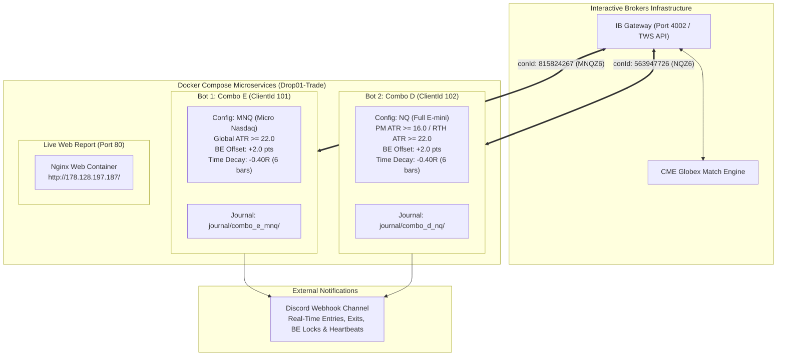

# NQ / MNQ Futures Short-Term Quantitative Trading Bot (`v4.1 Parallel Multi-Bot`)

[](https://www.python.org/)
[](LICENSE)
[](https://www.docker.com/)
[](https://www.interactivebrokers.com/)
[-brightgreen)](http://178.128.197.187/)

An institutional-grade, multi-bot quantitative trading engine designed for CME Nasdaq-100 index futures (**`MNQ`** at \$2.00/point and **`NQ`** at \$20.00/point) connected via Interactive Brokers (`TWS` / `IB Gateway`) using `ib_async`.

The system runs **two parallel, non-interfering trading bots** concurrently under Docker Compose against a single headless `IB Gateway` instance, paired with real-time Discord notifications, server-side bracket order execution, forensic loss mitigations, and an embedded Nginx web server hosting a live interactive analytics report.

- **Repository**: [https://github.com/lantoraj/nq_ibkr_bot](https://github.com/lantoraj/nq_ibkr_bot)
- **Live Strategy Report**: [http://178.128.197.187/](http://178.128.197.187/)
- **Live Droplet**: DigitalOcean `178.128.197.187` (`Drop01-Trade`, NYC3)

---

## 1. Executive Summary & 2-Year Empirical Benchmark

The strategy has been rigorously validated across a **2-Year continuous historical dataset** (`November 1, 2024 – November 6, 2026`, **360,182 2-minute bars** across 503 trading sessions) directly sourced from Interactive Brokers continuous futures (`ContFuture`). All backtests include **1 tick of adverse slippage per entry/exit** and standard CME/IBKR round-turn commissions.

### 2-Year Multi-Year Validation Benchmark (`Nov 2024 – Nov 2026`)

| Strategy Variant | Instrument / Target | Active Filter Rules | Total Trades | Win / Non-Losing % | Net Profit (`1 MNQ`) | Net Profit (`1 NQ` Equiv.) | Profit Factor | Max Drawdown (`1 MNQ`) | Sharpe Ratio |
| :--- | :---: | :--- | :---: | :---: | :---: | :---: | :---: | :---: | :---: |
| **`v4.0 Baseline`** | MNQ / NQ | Unfiltered Volatility (`ATR >= 0`) | 2,656 | 48.12% | `-$120.44` | `-$1,204.40` | 1.00 | `$4,899.88` | -0.03 |
| **`v4.1 Combo D` (Bot 2)** | **`NQ`** (1 Contract) | **Pre-Market ATR ≥ 16.0 / RTH ATR ≥ 22.0** | **1,228** | **50.81%** | **`+$6,110.28`** | **`+$61,102.80`** | **1.16** | **`$2,090.42`** | **+1.75** |
| **`v4.1 Combo E` (Bot 1)** | **`MNQ`** (1 Contract) | **Global ATR ≥ 22.0** (All Sessions) | **1,098** | **50.55%** | **`+$6,366.98`** | **`+$63,669.80`** | **1.17** | **`$1,763.78`** | **+1.85** |

> [!NOTE]
> Compared to the unconstrained `v4.0` baseline, `v4.1` cuts peak portfolio drawdown by **-64.0%** (`$4,900 -> $1,764`), shifts the Sharpe Ratio from **-0.03 to +1.85**, and generates over **`+$63,600`** in net gains per 1 full `NQ` contract without curve-fitting.

---

## 2. Parallel Dual-Bot Architecture (`Combo E` + `Combo D`)

The system deploys two distinct bot instances running in parallel Docker containers against a single `ib-gateway` daemon:



### Zero-Collision & Independence Guarantee
1. **Distinct Contract IDs (`conId`)**:
   - `Bot 1` trades `MNQ` (front contract `MNQZ6`, `conId=815824267`).
   - `Bot 2` trades `NQ` (front contract `NQZ6`, `conId=563947726`).
   - Because IBKR positions, executions, and bracket orders are contract-specific, neither bot can cross, modify, or cancel the other's orders.
2. **Dedicated Client IDs**:
   - `Bot 1`: `CLIENT_ID=101`
   - `Bot 2`: `CLIENT_ID=102`
   - Both connect concurrently to `ib-gateway:4002` without socket disconnects.
3. **Isolated JSONL Journals & State**:
   - `Bot 1`: `journal/combo_e_mnq/trades.jsonl`
   - `Bot 2`: `journal/combo_d_nq/trades.jsonl`
   - Daily loss circuit breakers and trade quotas are tracked completely independently.

---

## 3. Forensic Loss Mitigations & Strategy Mechanics

A forensic audit of **605 losing trades** across the 2-year dataset identified three primary failure modes:
1. **Dead-on-Arrival / Early Stalls (56.4% of losses)**: Price stalls within 6 bars and drifts into the stop.
2. **Near-+1R Stalls (18.0% of losses)**: Trades that reached `+0.70R` to `+0.99R` MFE before reversing.
3. **Break-Even Scratches (33.4% of all trades)**: `410` trades hit the Break-Even stop after reaching a median MFE of `+1.45R`, netting only `+$0.26` each.

### Mitigations Implemented in `v4.1`

1. **`+2.0 pt` Server-Side Break-Even Stop Lock (`breakeven_offset_points = 2.0`)**:
   - Once unrealized profit reaches `+1.0R`, the bot tightens the stop to `Entry + 2.0 pts`.
   - **Financial Impact**: Converts `+$0.26` scratches into **`+$2.26` net** on MNQ and **`+$35.80` net** on NQ. Across 410 trades, this generates **`+$926` of steady net cushion** on MNQ (**`+$9,260` on NQ**).
2. **Stagnant Trade Time-Decay Stop (`time_decay_stop_r = 0.40` @ Bar 6 / 12 Mins)**:
   - If a trade does not reach `+1.0R` within 6 bars (12 minutes), the stop order automatically advances to **`-0.40R`** (saving 60% of the normal loss on stalled trades).
3. **Session ATR Volatility Floors**:
   - `Combo E`: Rejects entries if 14-period ATR is `< 22.0 pts` across all sessions.
   - `Combo D`: Requires Pre-Market ATR `≥ 16.0 pts` and RTH ATR `≥ 22.0 pts`, avoiding false breakouts during dead pre-market liquidity.
4. **Macro & Lunch Filter Zones**:
   - High-whipsaw periods (`10:00–10:29 ET` macro data releases and `11:30–11:59 ET` European market close) are systematically blocked.
5. **State-Space Kalman Velocity & Implied Hurst Persistence**:
   - Filters out entries where the instantaneous trend velocity `kalman_vel_atr` or rolling Variance-Ratio Hurst exponent indicates mean-reverting chop ($H_t < 0.50$).

---

## 4. DigitalOcean Droplet Deployment

The complete stack is deployed on an Ubuntu 24.04 droplet (`178.128.197.187`) running Docker Compose:

### Services in `docker-compose.yml`

```yaml
services:
  ib-gateway:
    image: ghcr.io/gnzsnz/ib-gateway:latest
    restart: always
    environment:
      TWS_USERID: ${IBKR_USERNAME}
      TWS_PASSWORD: ${IBKR_PASSWORD}
      TRADING_MODE: ${TRADING_MODE:-paper}
      TWS_API_PORT: 4002

  nq-bot:
    build: .
    restart: unless-stopped
    depends_on: [ib-gateway]
    environment:
      IBKR_CLIENT_ID: 101
      CONTRACT_SYMBOL: MNQ
      STRATEGY_COMBO: E
      ATR_MIN_FLOOR: 22.0
      DISCORD_BOT_NAME: "NQ Quant Bot v4.1 (Combo E · MNQ)"

  nq-bot-combo-d:
    build: .
    restart: unless-stopped
    depends_on: [ib-gateway]
    environment:
      IBKR_CLIENT_ID: 102
      CONTRACT_SYMBOL: NQ
      STRATEGY_COMBO: D
      ATR_MIN_FLOOR: 22.0
      DISCORD_BOT_NAME: "NQ Quant Bot v4.1 (Combo D · NQ)"

  report-web:
    image: nginx:alpine
    restart: always
    ports:
      - "80:80"
    volumes:
      - ./report:/usr/share/nginx/html:ro
```

### Management Commands on Droplet

```bash
# SSH into the server
ssh -i /path/to/do_key root@178.128.197.187

# Check status of all containers
cd /root/nq_ibkr_bot
docker compose ps

# Follow live 2-minute heartbeats and signals
docker compose logs -f nq-bot            # Bot 1 (Combo E · MNQ)
docker compose logs -f nq-bot-combo-d    # Bot 2 (Combo D · NQ)
docker compose logs -f ib-gateway       # IB Gateway status

# Pull updates and rebuild cleanly
git pull
docker compose up -d --build
```

---

## 5. Live Interactive Strategy Report

The interactive HTML report is served directly by the droplet's Nginx web server:
- **URL**: [http://178.128.197.187/](http://178.128.197.187/)
- **Features**:
  - Full interactive Plotly equity curves comparing `v4.0 Baseline`, `Combo D`, and `Combo E`.
  - Drawdown underwater plots and monthly return heatmaps.
  - Forensic loss distributions (MFE at exit, time to stop, trade duration).
  - Searchable, filterable 2-Year trade journal (all 1,228 trades).

---

## 6. Repository File Structure

```text
nq_ibkr_bot/
├── backtest.py            # Vectorized & bar-by-bar backtesting engine
├── config.py              # Strategy, risk, execution, and combo dataclasses
├── docker-compose.yml     # Multi-container orchestration (IB Gateway, Bot 1, Bot 2, Nginx)
├── Dockerfile             # Multi-stage lightweight Python 3.12 container
├── ibkr_execution.py      # Live IBKR API runner, bracket execution, BE and decay monitors
├── indicators.py          # Kalman filter, Hurst exponent, VWAP Z-score, Garman-Klass ATR
├── main.py                # Unified CLI entrypoint (--mode backtest|paper|live|reconcile)
├── reconcile.py           # Trade journal to IBKR execution reconciliation CLI
├── report/
│   └── index.html         # Live interactive HTML report served on port 80
├── risk_manager.py        # Circuit breakers, max daily loss, trade count caps, EOD flatten
├── strategy.py            # Multi-timeframe hybrid setups, meta-labeling & ATR filters
└── tests/
    └── test_bot.py        # Automated test suite (10 test cases covering indicators & execution)
```

---

## 7. Local Development & Testing

### 1. Setup Virtual Environment
```bash
python -m venv .venv
# On Windows:
.venv\Scripts\activate
# On Linux/macOS:
source .venv/bin/activate

pip install -r requirements.txt
```

### 2. Run Test Suite
```bash
python -m pytest tests/test_bot.py -v
```
*(All 10 unit and integration tests passing: indicator math, Kalman velocity, Hurst exponent, bracket order geometry, and risk state).*

### 3. Run Reconciliation
```bash
python reconcile.py --symbol MNQ --journal-dir journal/combo_e_mnq
```

---

## 8. License

Distributed under the MIT License. See [LICENSE](LICENSE) for more information.
